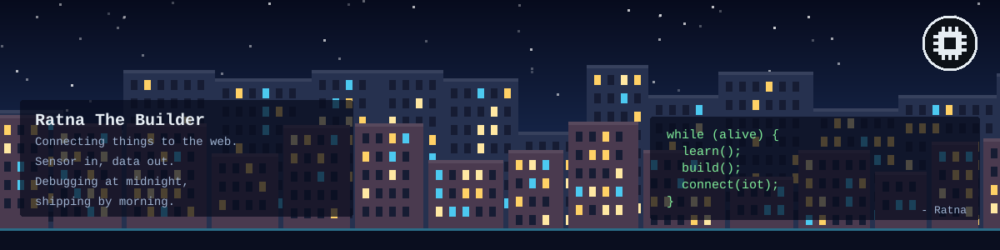
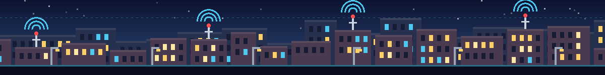

 

<h2 align="center">Hi 👋 I'm Ratna</h2>

## 💫 About Me

<table>
<tr>
<td width="55%" valign="top">

🌟 Memulai perjalanan di dunia pemrograman lewat **Web Development**

🌙 Mengerjakan frontend & desain web saat butuh jeda dari logika backend

🌱 Sedang menempuh **Teknik Informatika** di **Politeknik Negeri Malang**

📡 Tertarik menghubungkan dunia fisik dan digital lewat **IoT**

💬 Tanya saya soal **Web Development, Frontend, UI/UX Basics, IoT dasar**

⚡ Suka struktur data, algoritma, dan sistem yang rapi

✨ Belajar sesuatu yang baru tiap minggu

</td>
<td width="45%" valign="middle" align="center">

</td>
</tr>
</table>

🌟 **Follow Me on:**

<h3 align="center">🧰 Languages & Tools I Have Placed My Hands On</h3>

<h3 align="center">⚡ 📊 GitHub Stats</h3>

 

<h3 align="center">🖥️ Tech Stack:</h3>

<table align="center">
<tr>
<td align="center" width="50%">

### ⭐ Top Contributed Repo

</td>
<td align="center" width="50%">

### ✍️ Random Dev Quote

</td>
</tr>
</table>

<h2 align="center">Support Me 💰</h2>

 

