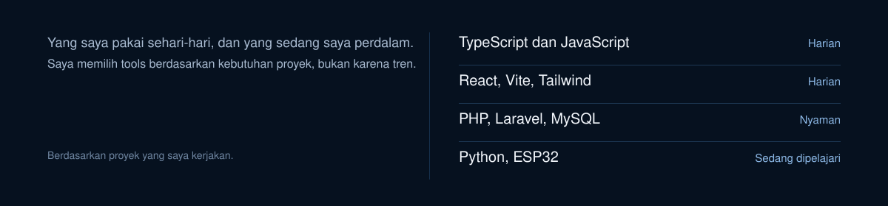

[LinkedIn](https://www.linkedin.com/in/aiinin-ratna-91b4903a9/) · [Email](mailto:aiininratna9@gmail.com) · [Instagram](https://instagram.com/aiininratna) · [GitHub](https://github.com/aiininratnadwitanti)

 

### KedataForm Studio

Aplikasi pembuat formulir dengan backend Express dan MySQL, login Google OAuth 2.0, serta frontend React 19, Vite, dan Tailwind. Seluruh data form, respons, dan pengguna tersimpan di MySQL.

React, TypeScript, Express, MySQL

[Repo](https://github.com/aiininratnadwitanti/kedataform) · [Demo](https://kedataform.vercel.app)

---

### Kost Finder

Prototype UI/UX aplikasi pencarian kost: alur pencarian, filter, dan tampilan detail dengan data contoh. Fokus pada desain antarmuka, tanpa backend.

React, TypeScript, UI/UX

[Repo](https://github.com/aiininratnadwitanti/kost-finder)

---

### PatunganBeres

Aplikasi split bill dan iuran bersama: scan struk dengan AI, hitung pajak dan service charge, lalu bagikan struk digital ke tiap peserta.

Laravel, PHP, MySQL, Gemini AI

[Repo](https://github.com/aiininratnadwitanti/patunganberes)

#### Pengalaman profesional

| Peran | Detail |
| :--- | :--- |
| **Magang**, PT Kedata Indonesia Digital, Yogyakarta 5 bulan | Terlibat dalam pengerjaan berbagai proyek website, mulai dari sistem keuangan terintegrasi AI, website pemesanan penginapan, platform pembelajaran mahasiswa berbasis AI, hingga aplikasi Form Builder. |
| **PKL**, PT Kedata Indonesia Digital, Yogyakarta 3 bulan | Memperoleh pengalaman kerja di bidang teknologi digital serta terlibat dalam proses pengerjaan proyek website dan pengembangan aplikasi. |
| **Helper fotografer**, Studio Foto Finest 3 bulan · 2022-2023 | Membantu persiapan studio, penataan properti, peralatan fotografi, dan proses pemotretan. |
| **PKL**, CV Meidita Seni Kreasi, Tulungagung 3 bulan · 2022-2023 | Bertugas sebagai helper fotografer dengan membantu persiapan peralatan dan kebutuhan pemotretan serta mendukung kegiatan operasional fotografi. |

#### Organisasi dan kampus

| Peran | Detail |
| :--- | :--- |
| **Keterlibatan dalam penelitian dosen** | Membantu proses pengumpulan data penelitian melalui pencarian, koordinasi, dan pengumpulan responden. |
| **Volunteer kampus dan PKKMB (tim PDD)** | Terlibat dalam berbagai kegiatan kampus sebagai tim Publikasi, Dekorasi, dan Dokumentasi (PDD), termasuk membantu persiapan dan pelaksanaan acara. |
| **UKM Multimedia** | Mengikuti kegiatan UKM Multimedia untuk mengembangkan kemampuan di bidang multimedia, berorganisasi, dan bekerja sama dalam tim. |

 

  
  

  

<a href="https://github.com/aiininratnadwitanti?tab=repositories">Lihat semua repositori</a>

Terbuka untuk kolaborasi, proyek freelance, atau diskusi seputar web dan desain antarmuka.

[Kirim email](mailto:aiininratna9@gmail.com) · [LinkedIn](https://www.linkedin.com/in/aiinin-ratna-91b4903a9/) · [GitHub](https://github.com/aiininratnadwitanti) · [Instagram](https://instagram.com/aiininratna)

 

