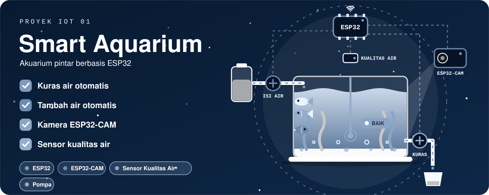
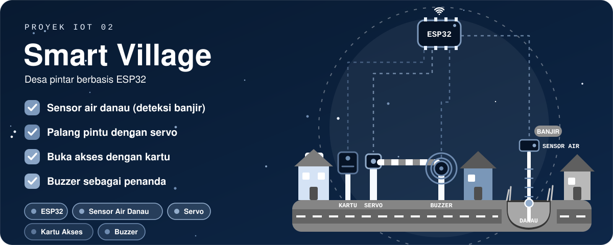
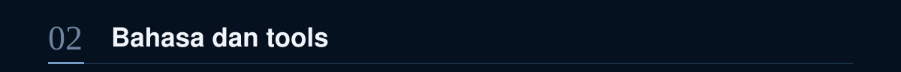
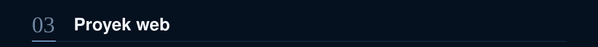
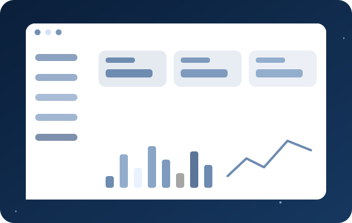

 

  

  

  

  

  

### KedataForm Studio
Aplikasi pembuat formulir dengan backend Express + MySQL dan login Google OAuth 2.0. Frontend React 19, Vite, dan Tailwind, dengan seluruh data form, respons, dan pengguna tersimpan di MySQL.

`React` `TypeScript` `Express` `MySQL`

[Repo](https://github.com/aiininratnadwitanti/kedataform) · [Demo](https://kedataform.vercel.app)

 
 

### Kost Finder
Prototype UI/UX aplikasi pencarian kost: alur pencarian, filter, dan tampilan detail dengan data contoh. Fokus pada desain antarmuka, tanpa backend.

`React` `TypeScript` `UI/UX` `Prototype`

[Repo](https://github.com/aiininratnadwitanti/kost-finder)

 
 

### PatunganBeres
Aplikasi split bill dan iuran bersama: scan struk dengan AI, hitung pajak dan service charge secara transparan, lalu bagikan struk digital ke tiap peserta.

`Laravel` `PHP` `MySQL` `Gemini AI`

[Repo](https://github.com/aiininratnadwitanti/patunganberes)

 

 

#### Pengalaman Profesional

| Peran | Detail |
| :--- | :--- |
| **Magang**, PT Kedata Indonesia Digital, Yogyakarta 5 bulan | Terlibat dalam pengerjaan berbagai proyek website, mulai dari sistem keuangan terintegrasi AI, website pemesanan penginapan, platform pembelajaran mahasiswa berbasis AI, hingga aplikasi Form Builder. |
| **PKL**, PT Kedata Indonesia Digital, Yogyakarta 3 bulan | Memperoleh pengalaman kerja di bidang teknologi digital serta terlibat dalam proses pengerjaan proyek website dan pengembangan aplikasi. |
| **Helper Fotografer**, Studio Foto Finest 3 bulan · 2022-2023 | Membantu persiapan studio, penataan properti, peralatan fotografi, dan proses pemotretan. |
| **PKL**, CV Meidita Seni Kreasi, Tulungagung 3 bulan · 2022-2023 | Bertugas sebagai helper fotografer dengan membantu persiapan peralatan dan kebutuhan pemotretan serta mendukung kegiatan operasional fotografi. |

#### Organisasi dan Kampus

| Peran | Detail |
| :--- | :--- |
| **Keterlibatan dalam Penelitian Dosen** | Membantu proses pengumpulan data penelitian melalui pencarian, koordinasi, dan pengumpulan responden. |
| **Volunteer Kampus dan PKKMB (Tim PDD)** | Terlibat dalam berbagai kegiatan kampus sebagai tim Publikasi, Dekorasi, dan Dokumentasi (PDD), termasuk membantu persiapan dan pelaksanaan acara. |
| **UKM Multimedia** | Mengikuti kegiatan UKM Multimedia untuk mengembangkan kemampuan di bidang multimedia, berorganisasi, dan bekerja sama dalam tim. |

  

  
  

  

<a href="https://github.com/aiininratnadwitanti?tab=repositories">Lihat semua repositori</a>

  

**Punya ide, proyek, atau kolaborasi yang ingin dikerjakan bersama?**

Terbuka untuk diskusi desain, pengembangan web, dan eksplorasi IoT.

[Email](mailto:aiininratna9@gmail.com) · [LinkedIn](https://www.linkedin.com/in/aiinin-ratna-91b4903a9/) · [GitHub](https://github.com/aiininratnadwitanti) · [Instagram](https://instagram.com/aiininratna)

 

