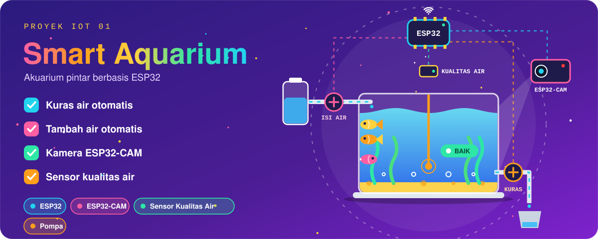
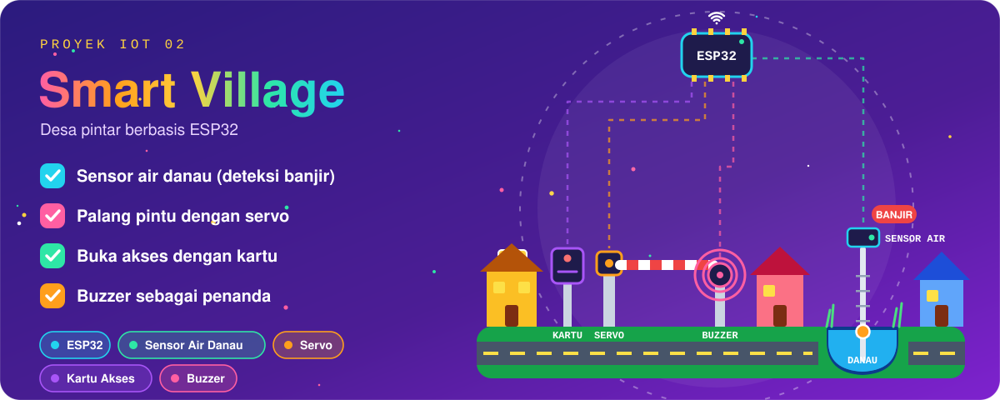
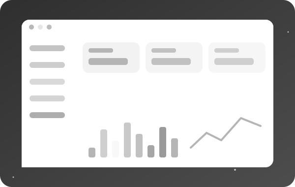
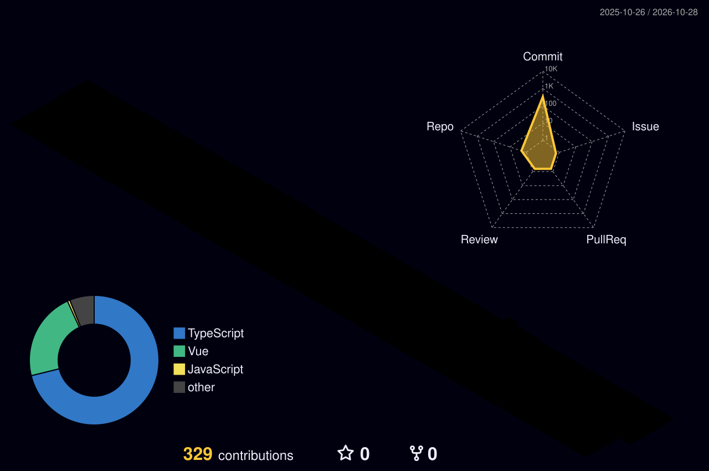

 

  

  

  

  

 

  

### 🧩 Nama Proyek Web 1
Deskripsi singkat proyek: masalah yang diselesaikan dan siapa penggunanya.

`React` `Node.js` `MySQL`

[🔗 Lihat Repo](https://github.com/aiininratnadwitanti/NAMA_REPO_1)

 
 

### 🌐 Nama Proyek Web 2
Deskripsi singkat proyek: fitur utama dan teknologi yang dipakai.

`HTML` `CSS` `JavaScript`

[🔗 Lihat Repo](https://github.com/aiininratnadwitanti/NAMA_REPO_2)

 
 

### 📱 Nama Proyek Web 3
Deskripsi singkat proyek: fitur utama dan teknologi yang dipakai.

`PHP` `MySQL` `Tailwind`

[🔗 Lihat Repo](https://github.com/aiininratnadwitanti/NAMA_REPO_3)

 

 

 

 

